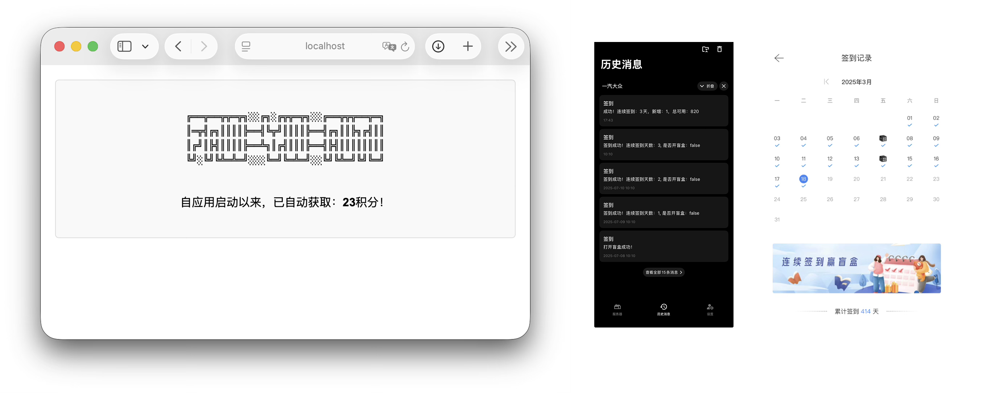

<div>
    
</div>

# faw-vw-auto
一汽大众自动定时签到获取积分，Release版本只编译了macOS（M系列芯片）环境的程序包，其他平台可自行下载编译。
<div>
    
</div>

## 有哪些功能
- 每日签到
- 连续签到7天，自动打开盲盒奖励；获取额外积分
- 支持Bark推送签到结果至iPhone
- 支持Docker容器运行

## 如何使用
无论使用哪种平台运行，均需配置 `env.yaml` 文件存储账号和签到参数。  
配置文件参数说明：

| 参数名               | 说明                                                                                     | 是否必填 |示例|
|----------------------|----------------------------------------------------------------------------------------|----------|----------|
| `mobile`             | 一汽大众APP注册手机号                                                                   | ✅ 必填   | 13012345678 |
| `password`           | 密码密文（需通过浏览器登录Web版，查看`https://vw.faw-vw.com/api/business/cpoint/registeOrLogin` 获取 Request Body 中的密文） | ✅ 必填   | a1b2c3d4e5f6... |
| `WebDid`             | 设备ID（同上，获取 Request Body 中的 `did` 参数）                                    | ✅ 必填   | Safari 18.2_528ssssss_Mac OS X ｜
| `BarkPushServerURL`  | Bark推送地址（用于iPhone签到结果推送，不需要可留空）                                     | ❌ 可选   | https://api.day.app/yourkey |
| `securityCode`       | 客户端签到接口必填参数（抓包App登录接口 `https://oneapp-api.faw-vw.com/account/login/loginByPassword/v1` 获取） | ✅ 必填   | 7a8b9c0d1e2f... |
| `did`                | 客户端设备ID（抓包同上接口获取）                                                        | ✅ 必填   | VW_APP_iPhone_XXXXXXXXXXXXXXXXXXXX_15.1_4.0.18 | 


---

#### Docker环境
1. **安装Docker**  
   - 确保已安装Docker，具体安装请参考 [Docker官方文档](https://docs.docker.com/get-docker/)。
2. **运行容器**
   - 使用以下命令拉取并运行容器：
    ```bash
    docker run -d \
    -v /your/local/path/env.yaml:/app/env.yaml \  # 挂载配置文件
    hytaoist/faw_vw_auto:latest # 将 /your/local/path/env.yaml 替换为本地配置文件实际路径。
    ```

#### macOS（M系列芯片）
1. **下载程序**  
   - 从 [Release页面](https://github.com/hytaoist/faw-vw-auto/releases) 下载最新版 `faw_vw_auto_darwin`，解压至任意目录。
2. **配置环境**  
   - 编辑同目录下的 `env.yaml` 文件，填写上述参数。
3. **运行程序**  
   ```bash
   nohup ./faw_vw_auto_darwin &  # 后台运行


## 注意事项‼️‼️‼️
- 本项目仅供学习交流使用，请勿用于商业用途。
- 因涉及账户密码，请勿将env.yaml文件上传至公共仓库，以免泄露个人信息。

# 在青龙 (QingLong) 上部署 faw-vw-auto

本节说明如何在青龙面板中运行本项目。仓库根目录提供了脚本 `qinglong_run.sh`，用于在青龙任务中启动程序，支持直接使用环境变量或生成 `env.yaml` 两种方式。

## 支持的环境变量

推荐使用下面的环境变量方式（青龙任务的「环境变量」字段或脚本中 export）：

- `FAW_MOBILE` - 登录手机（必填）
- `FAW_PASSWORD` - 密码密文（必填）
- `FAW_WEBDID` - WebDid（必填）
- `FAW_BARK_PUSH_SERVER_URL` - Bark 推送地址（可选）
- `FAW_SECURITY_CODE` - securityCode（必填）
- `FAW_DID` - did（必填）
- `FAW_EXEC_FREQ` - 执行频率（与原 `env.yaml` 中相同格式，可选）
- `CREATE_ENV_YAML` - 如果设置为 `1`，脚本会根据上面 FAW_* 变量生成 `env.yaml` 并让程序读取该文件（场景：你希望使用文件而非环境变量）
- `FAW_RUN_ONCE` - 若设置为 `1`，程序只运行一次签到任务后退出（推荐在青龙任务中使用）

## 方式 A：环境变量直接运行（推荐）

1. 在青龙任务的「环境变量」中添加必需的 `FAW_*` 变量。
2. 在「命令」中写入（假设仓库克隆到 /ql/repo/faw-vw-auto）：

```bash
#!/bin/bash
cd /ql/repo/faw-vw-auto
./qinglong_run.sh
```

脚本会设置 `FAW_USE_ENV=1`，并直接以当前环境变量启动程序。

注意：若你希望青龙负责调度，请在环境变量中设置 `FAW_RUN_ONCE=1`，以避免与程序内部 cron 冲突。

## 方式 B：生成 `env.yaml` 并让程序读取

如果你更喜欢程序读取 `env.yaml` 文件（例如某些日志或调试需求），在青龙任务中设置 `CREATE_ENV_YAML=1`，脚本会在当前目录生成 `env.yaml`，并取消环境变量优先，使程序读取生成的文件。

## 说明

- 请将项目二进制放在脚本同目录，或确保二进制名 `faw-vw-auto` 在 PATH 中；脚本会优先使用同目录的可执行文件。
- 若需要在青龙中持久化 `env.yaml`，请将脚本目录指向可持久化路径或在脚本中将生成文件移动到合适位置。
- 为安全，请勿将敏感变量写入公共日志或推送到公开仓库。

## 常见问题

- 脚本未找到二进制：请在仓库根运行 `go build -o faw-vw-auto .`，将生成的二进制与脚本放同目录。